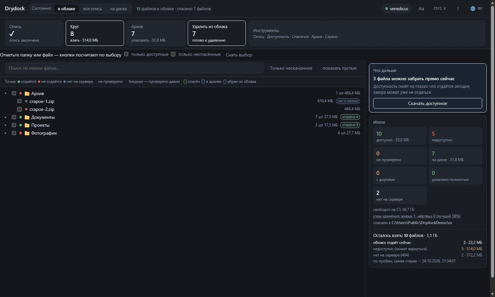

# Drydock

Спасает файлы с Яндекс.Диска, когда облако перестаёт их отдавать: описывает
коллекцию, проверяет доступность, качает то, что отдаётся, сверяет хеши,
пакует в архивы.

**Русский** · [English](docs/README.en.md) · [Türkçe](docs/README.tr.md) ·
[Қазақша](docs/README.kk.md) · [Oʻzbekcha](docs/README.uz.md) ·
[Azərbaycanca](docs/README.az.md)

MIT · Windows · Python 3.12+ · не связан с Яндексом

[](https://venedicus.github.io/drydock/)




## Что умеет

| Действие | Что делает |
|---|---|
| **Опись** | обходит облако и записывает имя, размер, хеши и место в дереве — включая файлы, которые уже не скачать |
| **Проба** | проверяет доступность без скачивания: первый и последний байт |
| **Круг** | качает всё, что отдаётся, и перепроверяет недоступное, пока не остановишь |
| **Архив** | пакует спасённое в тома 3.9 ГБ, 1.9 ГБ или одним файлом |
| **Удаление** | освобождает облако тем, что уже проверено; три уровня строгости |
| **Здоровье** | показывает, почему не выходит: причины отказов, узлы, задачи |

Ещё: превью, учёт файлов, спасённых вручную, сверка зеркала с диском,
автопилот, командная палитра `Ctrl+K`, шесть языков, тёмная и светлая темы.

## Как поставить

**Готовый файл** — `Drydock.exe` из [релизов](https://github.com/venedicus/drydock/releases/latest).
Python не нужен, нужен только [7-Zip](https://www.7-zip.org/).

**Из исходников** — Windows, Python 3.12+ и 7-Zip:

```powershell
git clone https://github.com/venedicus/drydock.git
cd drydock
py -3.12 -m venv .venv
.venv\Scripts\python.exe -m pip install -e .
```

Запуск — `Drydock.exe` или `Drydock.bat`. Окно открывается на `http://127.0.0.1:8765`.

1. **Доступ** — вставить токен из [полигона Яндекса](https://yandex.ru/dev/disk/poligon/)
   или задать `YANDEX_DISK_TOKEN`.
2. **Настройки** — выбрать папку для `files/`, `meta/`, `archives/`, `catalog.db`.
3. **Опись** — дождаться конца.
4. **Круг** — оставить работать.

## Документы

- [Как это работает](docs/how-it-works.md) — опись, проба, выгрузка, проверка, архив, удаление
- [Ограничения](docs/limitations.md) — чего программа не делает и почему
- [Сравнение](docs/comparison.md) — Drydock, клиент синхронизации и rclone
- [Участие](CONTRIBUTING.md) · [Безопасность](SECURITY.md) · [Изменения](CHANGELOG.md)

## Чем помочь

- **Поставить звезду** — по ней проект находят другие.
- **Поблагодарить автора** — [страница с реквизитами](https://venedicus.github.io/drydock/).
- **Рассказать, если помогло** — issue с историей: сколько файлов, что не вышло.
- **Сообщить, где числа разошлись** — это важнее новых возможностей.
- **Поправить перевод** — языков шесть, любой может отстать от кода.

---

© 2026 venedicus · MIT · «Яндекс.Диск» — товарный знак правообладателя,
проект с Яндексом не связан.
