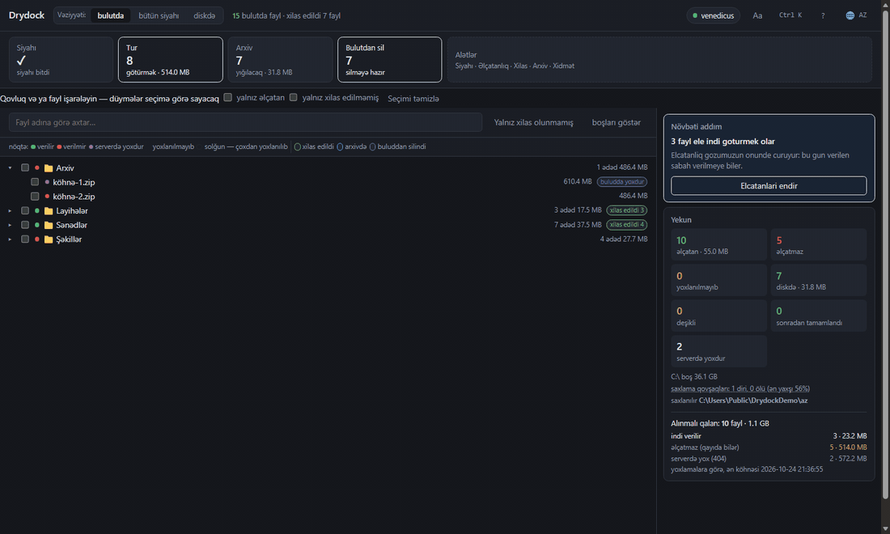

# Drydock

Bulud faylları verməyi dayandıranda Yandex.Disk-dən xilas edir: kolleksiyanı
siyahıya alır, əlçatanlığı yoxlayır, veriləni endirir, heşləri tutuşdurur,
arxivlərə yığır.

Öz kolleksiyam üçün yazılıb: ilk gün yarısını çıxardı, indi təxminən 98%-ni.
Fayllar gah verilir, gah verilmir, ona görə turu söndürməmək daha yaxşıdır.

[Русский](../README.md) · [English](README.en.md) · [Türkçe](README.tr.md) ·
[Қазақша](README.kk.md) · [Oʻzbekcha](README.uz.md) · **Azərbaycanca**

MIT · Windows · Python 3.12+ · Yandex ilə əlaqəli deyil

[](https://venedicus.github.io/drydock/)




## Nə edir

| Əməliyyat | Nə edir |
|---|---|
| **Siyahı** | buludu gəzib adı, ölçüsü, heşləri və ağacdakı yerini yazır — artıq endirilə bilməyənlər də daxil |
| **Yoxlama** | endirmədən əlçatanlığı yoxlayır: ilk və son bayt |
| **Tur** | verilən hər şeyi endirir, verilməyənləri dayandırana qədər yenidən yoxlayır |
| **Arxiv** | xilas ediləni 3.9 GB, 1.9 GB cildlərə və ya bir fayla yığır |
| **Silmə** | yoxlanılmışlarla buludu boşaldır; üç səviyyə |
| **Sağlamlıq** | niyə alınmadığını göstərir: səbəblər, qovşaqlar, tapşırıqlar |

Həmçinin: önizləmələr, əllə xilas edilən faylların hesaba alınması, aynanın
disklə tutuşdurulması, avtopilot, `Ctrl+K` palitrası, altı dil, tünd və işıqlı mövzu.

## Sürətli başlanğıc

Windows, Python 3.12+ və [7-Zip](https://www.7-zip.org/) lazımdır.

**Hazır fayl** — [relizlərdən](https://github.com/venedicus/drydock/releases/latest) `Drydock.exe`. Python lazım deyil, yalnızca [7-Zip](https://www.7-zip.org/).

```powershell
git clone https://github.com/venedicus/drydock.git
cd drydock
py -3.12 -m venv .venv
.venv\Scripts\python.exe -m pip install -e .
```

`Drydock.bat` ilə başladın. Pəncərə `http://127.0.0.1:8765` ünvanında açılır.

1. **Giriş** — [Yandex poliqonundan](https://yandex.ru/dev/disk/poligon/) tokeni
   qoyun və ya `YANDEX_DISK_TOKEN` təyin edin.
2. **Ayarlar** — `files/`, `meta/`, `archives/`, `catalog.db` üçün qovluq seçin.
3. **Siyahı** — bitməsini gözləyin.
4. **Tur** — işləməyə buraxın.

## Sənədlər

- [Necə işləyir](how-it-works.en.md) — siyahı, yoxlama, endirmə, tutuşdurma, arxiv, silmə
- [Məhdudiyyətlər](limitations.en.md) — nə etmir və niyə
- [Müqayisə](comparison.en.md) — Drydock, sinxronizasiya klienti və rclone
- [İştirak](../CONTRIBUTING.md) · [Təhlükəsizlik](../SECURITY.md) · [Dəyişikliklər](../CHANGELOG.md)

## Necə kömək etmək olar

- **Ulduz qoymaq** — insanlar layihəni bununla tapır.
- **Müəllifə təşəkkür** — [ianə səhifəsi](https://venedicus.github.io/drydock/).
- **Kömək etdisə, danışmaq** — rəqəmlərlə issue: neçə fayl, nə alınmadı.
- **Rəqəmlər uyğun gəlmirsə, bildirmək** — bu yeni imkanlardan vacibdir.
- **Tərcüməni düzəltmək** — altı dil var, hər biri koddan geri qala bilər.

---

© 2026 venedicus · MIT · “Yandex.Disk” hüquq sahibinin ticarət nişanıdır; layihə
Yandex ilə əlaqəli deyil.
