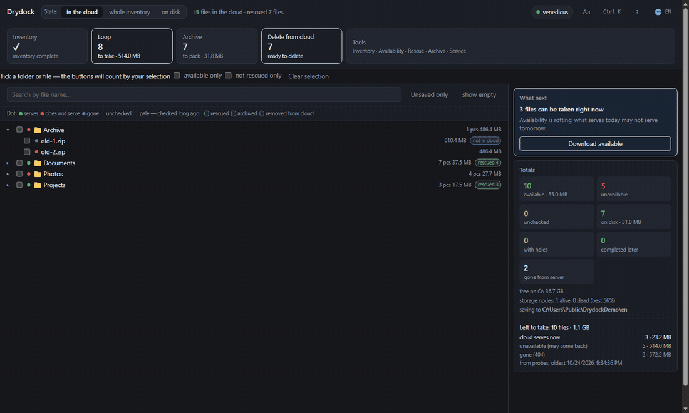

# Drydock

Rescues files from Yandex.Disk when the cloud stops serving them: inventories
the collection, probes availability, downloads what is still served, verifies
hashes, packs into archives.

Built for a real collection: half of it on the first day, almost 98% now.
Files come and go, so the loop is worth leaving on.

[Русский](../README.md) · **English** · [Türkçe](README.tr.md) ·
[Қазақша](README.kk.md) · [Oʻzbekcha](README.uz.md) ·
[Azərbaycanca](README.az.md)

MIT · Windows · Python 3.12+ · not affiliated with Yandex

[](https://venedicus.github.io/drydock/)




## What it does

| Action | What it does |
|---|---|
| **Inventory** | walks the cloud and records name, size, hashes and place in the tree — including files that can no longer be downloaded |
| **Probe** | checks availability without downloading: first and last byte |
| **Loop** | downloads everything that is served and re-checks the rest until stopped |
| **Archive** | packs what was rescued into 3.9 GB volumes, 1.9 GB volumes or a single file |
| **Delete** | frees the cloud with what is already verified; three strictness levels |
| **Health** | shows why it fails: reasons, nodes, jobs |
| **Export** | writes the inventory to CSV or JSON: path, size, availability, hashes, where the rescued copy is |

Also: previews, registering files rescued by hand, mirror sync with the disk,
autopilot, command palette `Ctrl+K`, six languages, dark and light themes.

## How to install

**Ready-made file** — `Drydock.exe` from [releases](https://github.com/venedicus/drydock/releases/latest).
No Python needed, only [7-Zip](https://www.7-zip.org/).

**From sources** — Windows, Python 3.12+ and 7-Zip:

```powershell
git clone https://github.com/venedicus/drydock.git
cd drydock
py -3.12 -m venv .venv
.venv\Scripts\python.exe -m pip install -e .
```

Start with `Drydock.exe` or `Drydock.bat`. The window opens at `http://127.0.0.1:8765`.

1. **Access** — paste a token from the [Yandex polygon](https://yandex.ru/dev/disk/poligon/)
   or set `YANDEX_DISK_TOKEN`.
2. **Settings** — pick the folder for `files/`, `meta/`, `archives/`, `catalog.db`.
3. **Inventory** — wait until it finishes.
4. **Loop** — leave it running.

## Documents

- [How it works](how-it-works.en.md) — inventory, probe, download, verification, archive, delete
- [Limitations](limitations.en.md) — what it does not do, and why
- [Comparison](comparison.en.md) — Drydock, a sync client and rclone
- [Contributing](../CONTRIBUTING.md) · [Security](../SECURITY.md) · [Changelog](../CHANGELOG.md)

## How to help

- **Star the repo** — that is how others find it.
- **Thank the author** — [donation page](https://venedicus.github.io/drydock/).
- **Tell your story if it helped** — an issue with the numbers: how many files, what failed.
- **Report a mismatch in numbers** — that matters more than new features.
- **Fix a translation** — there are six languages, any of them can lag behind the code.

[](https://yoomoney.ru/to/4100117869777196) [](https://venedicus.github.io/drydock/) [](https://venedicus.github.io/drydock/) [](https://venedicus.github.io/drydock/)

<details>
<summary>Donation details</summary>

| Network | Address |
|---|---|
| Bitcoin (BTC, SegWit) | `bc1qaj3jllqse90sqcrfvtyv5ll7le2guh0q30prp2` |
| Bitcoin Lightning | `venedicus@cake.cash` |
| Ethereum (ETH, ERC-20) | `0x1e728B3568c9072A749694dEa116b1c8331fD43a` |
| BNB Chain (BNB, BEP-20) | `0x1e728B3568c9072A749694dEa116b1c8331fD43a` |
| Polygon (POL) | `0x1e728B3568c9072A749694dEa116b1c8331fD43a` |
| TON (TON, USDT) | `UQBKSMU3B9OFfaqWK3iQBCyifZjCEgF8m4kBsO-Tu5U4Grx1` |
| Tron (TRX, USDT TRC-20) | `TMibQMbptanys3JVgZxpHucQLZsWGTihzg` |
| Solana (SOL, SPL) | `5xb56pkcUk473d13MKADLdBNtuA2v4qFukSpWermZhm3` |
| Dogecoin (DOGE) | `D7VGb1PsLqr5RSnFmiwCz81zTq9gPsUTng` |
| Litecoin (LTC) | `ltc1qp0wfw2hezl94c4c3cl6yeya4wcczck2ttjaun8` |
| Monero (XMR) | `45LuFsk9rr7JwepcsfaspeTwyUVy7QbbWUbA1hsBj374h3BPhyPvpqWLVfQM9kDJBddZKsQcNbDEhS3ZTdoritJvGLdsWPF` |

Ethereum, BNB Chain and Polygon share one address — pick the network when sending. Card, SBP and YooMoney: [payment page](https://yoomoney.ru/to/4100117869777196).

</details>

---

© 2026 venedicus · MIT · “Yandex.Disk” is a trademark of its owner; this
project is not affiliated with Yandex.
