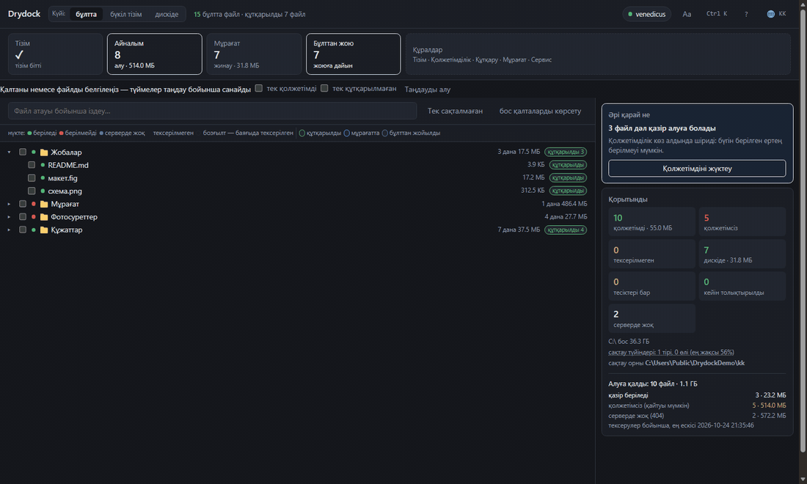

# Drydock

Бұлт файлдарды беруді тоқтатқанда Yandex.Disk-тен құтқарады: коллекцияны
тізімдейді, қолжетімділікті тексереді, берілгенін жүктейді, хештерді
салыстырады, мұрағаттарға жинайды.

Өз коллекцияма арналып жазылды: бірінші күні жартысын шығарды, қазір 98%-ға
жуығы. Файлдар кейде беріледі, кейде берілмейді, сондықтан айналымды өшірмеген
жөн.

[Русский](../README.md) · [English](README.en.md) · [Türkçe](README.tr.md) ·
**Қазақша** · [Oʻzbekcha](README.uz.md) · [Azərbaycanca](README.az.md)

MIT · Windows · Python 3.12+ · Yandex-пен байланысы жоқ

[](https://venedicus.github.io/drydock/)




## Не істейді

| Әрекет | Не істейді |
|---|---|
| **Тізім** | бұлтты аралап, атын, өлшемін, хештерін және ағаштағы орнын жазады — енді жүктелмейтіндерді де қоса |
| **Тексеру** | жүктемей-ақ қолжетімділікті тексереді: бірінші және соңғы байт |
| **Айналым** | берілгеннің бәрін жүктейді, берілмейтіндерді тоқтатқанша қайта тексереді |
| **Мұрағат** | құтқарылғанды 3.9 ГБ, 1.9 ГБ томдарға немесе бір файлға жинайды |
| **Жою** | тексерілгенмен бұлтты босатады; үш деңгей |
| **Денсаулық** | неге шықпайтынын көрсетеді: себептер, түйіндер, тапсырмалар |

Қосымша: превью, қолмен құтқарылған файлдарды есепке алу, айнаны дискімен
салыстыру, автопилот, `Ctrl+K` палитрасы, алты тіл, қараңғы және ашық тақырып.

## Жылдам бастау

Windows, Python 3.12+ және [7-Zip](https://www.7-zip.org/) керек.

**Дайын файл** — [релиздерден](https://github.com/venedicus/drydock/releases/latest) `Drydock.exe`. Python қажет емес, тек [7-Zip](https://www.7-zip.org/).

```powershell
git clone https://github.com/venedicus/drydock.git
cd drydock
py -3.12 -m venv .venv
.venv\Scripts\python.exe -m pip install -e .
```

`Drydock.bat` арқылы іске қосыңыз. Терезе `http://127.0.0.1:8765` мекенжайында ашылады.

1. **Қатынас** — [Yandex полигонынан](https://yandex.ru/dev/disk/poligon/) токенді
   қойыңыз немесе `YANDEX_DISK_TOKEN` орнатыңыз.
2. **Баптаулар** — `files/`, `meta/`, `archives/`, `catalog.db` үшін қалта таңдаңыз.
3. **Тізім** — аяқталуын күтіңіз.
4. **Айналым** — жұмыс істеп тұрсын.

## Құжаттар

- [Қалай жұмыс істейді](how-it-works.en.md) — тізім, тексеру, жүктеу, салыстыру, мұрағат, жою
- [Шектеулер](limitations.en.md) — не істемейді және неге
- [Салыстыру](comparison.en.md) — Drydock, синхрондау клиенті және rclone
- [Қатысу](../CONTRIBUTING.md) · [Қауіпсіздік](../SECURITY.md) · [Өзгерістер](../CHANGELOG.md)

## Қалай көмектесуге болады

- **Жұлдызша қою** — адамдар жобаны сол арқылы табады.
- **Авторға алғыс** — [қайырымдылық беті](https://venedicus.github.io/drydock/).
- **Көмектессе, айту** — сандармен issue: қанша файл, не шықпады.
- **Сандар сәйкес келмесе, хабарлау** — бұл жаңа мүмкіндіктерден маңызды.
- **Аударманы түзету** — алты тіл бар, кез келгені кодтан қалып қалуы мүмкін.

[](https://yoomoney.ru/to/4100117869777196) [](https://venedicus.github.io/drydock/) [](https://venedicus.github.io/drydock/) [](https://venedicus.github.io/drydock/)

<details>
<summary>Аударым деректемелері</summary>

| Желі | Мекенжай |
|---|---|
| Bitcoin (BTC, SegWit) | `bc1qaj3jllqse90sqcrfvtyv5ll7le2guh0q30prp2` |
| Bitcoin Lightning | `venedicus@cake.cash` |
| Ethereum (ETH, ERC-20) | `0x1e728B3568c9072A749694dEa116b1c8331fD43a` |
| BNB Chain (BNB, BEP-20) | `0x1e728B3568c9072A749694dEa116b1c8331fD43a` |
| Polygon (POL) | `0x1e728B3568c9072A749694dEa116b1c8331fD43a` |
| TON (TON, USDT) | `UQBKSMU3B9OFfaqWK3iQBCyifZjCEgF8m4kBsO-Tu5U4Grx1` |
| Tron (TRX, USDT TRC-20) | `TMibQMbptanys3JVgZxpHucQLZsWGTihzg` |
| Solana (SOL, SPL) | `5xb56pkcUk473d13MKADLdBNtuA2v4qFukSpWermZhm3` |
| Dogecoin (DOGE) | `D7VGb1PsLqr5RSnFmiwCz81zTq9gPsUTng` |
| Litecoin (LTC) | `ltc1qp0wfw2hezl94c4c3cl6yeya4wcczck2ttjaun8` |
| Monero (XMR) | `45LuFsk9rr7JwepcsfaspeTwyUVy7QbbWUbA1hsBj374h3BPhyPvpqWLVfQM9kDJBddZKsQcNbDEhS3ZTdoritJvGLdsWPF` |

Желі монетадан маңызды: қате желіге аударымды қайтару мүмкін емес. Карта, СБП және ЮMoney: [төлем беті](https://yoomoney.ru/to/4100117869777196).

</details>

---

© 2026 venedicus · MIT · «Yandex.Disk» — құқық иесінің сауда белгісі, жоба
Yandex-пен байланысы жоқ.
