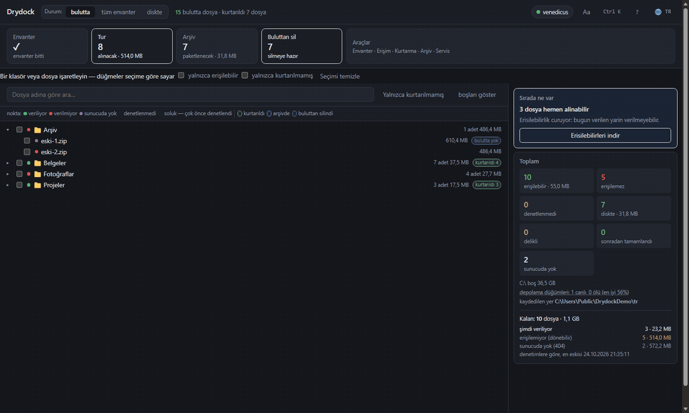

# Drydock

Bulut dosyaları vermeyi bıraktığında Yandex.Disk'ten kurtarır: koleksiyonu
listeler, erişilebilirliği denetler, verileni indirir, heşleri doğrular,
arşivlere paketler.

Kendi koleksiyonum için yazıldı: ilk gün yarısını çıkardı, şimdi neredeyse
%98'ini. Dosyalar bazen veriliyor bazen verilmiyor, o yüzden turu kapatmamak
mantıklı.

[Русский](../README.md) · [English](README.en.md) · **Türkçe** ·
[Қазақша](README.kk.md) · [Oʻzbekcha](README.uz.md) ·
[Azərbaycanca](README.az.md)

MIT · Windows · macOS · Linux · Python 3.12+ · Yandex ile bağlantılı değildir

[](https://venedicus.github.io/drydock/)




## Ne yapar

| Eylem | Ne yapar |
|---|---|
| **Envanter** | bulutu dolaşıp adı, boyutu, heşleri ve ağaçtaki yerini kaydeder — artık indirilemeyenler dahil |
| **Denetim** | indirmeden erişilebilirliği kontrol eder: ilk ve son bayt |
| **Tur** | verilen her şeyi indirir, verilmeyenleri durdurulana kadar yeniden dener |
| **Arşiv** | kurtarılanı 3.9 GB, 1.9 GB ciltlere veya tek dosyaya paketler |
| **Silme** | doğrulanmış olanlarla bulutu boşaltır; üç katı seviye |
| **Sağlık** | neden olmadığını gösterir: nedenler, düğümler, görevler |

Ayrıca: önizlemeler, elle kurtarılan dosyaların hesaba katılması, aynanın
diskle eşitlenmesi, otopilot, komut paleti `Ctrl+K`, altı dil, koyu ve açık tema.

## Hızlı başlangıç

Python 3.12+, [7-Zip](https://www.7-zip.org/) ve Windows, macOS ya da Linux gerekir.

**Hazır dosya** — [sürümlerden](https://github.com/venedicus/drydock/releases/latest) `Drydock.exe`. Python gerekmez, yalnızca [7-Zip](https://www.7-zip.org/).

```powershell
git clone https://github.com/venedicus/drydock.git
cd drydock
py -3.12 -m venv .venv
.venv\Scripts\python.exe -m pip install -e .
```

`Drydock.bat` ile başlatın. Pencere `http://127.0.0.1:8765` adresinde açılır.

1. **Erişim** — [Yandex poligonundan](https://yandex.ru/dev/disk/poligon/) belirteci
   yapıştırın veya `YANDEX_DISK_TOKEN` ayarlayın.
2. **Ayarlar** — `files/`, `meta/`, `archives/`, `catalog.db` için klasör seçin.
3. **Envanter** — bitmesini bekleyin.
4. **Tur** — çalışır bırakın.

## Belgeler

- [Nasıl çalışır](how-it-works.en.md) — envanter, denetim, indirme, doğrulama, arşiv, silme
- [Sınırlar](limitations.en.md) — ne yapmaz ve neden
- [Karşılaştırma](comparison.en.md) — Drydock, senkron istemcisi ve rclone
- [Katkı](../CONTRIBUTING.md) · [Güvenlik](../SECURITY.md) · [Değişiklikler](../CHANGELOG.md)

## Nasıl yardım edilir

- **Yıldız verin** — projeyi başkaları böyle buluyor.
- **Yazara teşekkür et** — [bağış sayfası](https://venedicus.github.io/drydock/).
- **İşe yaradıysa anlatın** — sayılarla bir issue: kaç dosya, ne olmadı.
- **Sayıların uyuşmadığını bildirin** — bu yeni özelliklerden daha önemli.
- **Çeviriyi düzeltin** — altı dil var, herhangi biri koddan geride kalabilir.

[](https://yoomoney.ru/to/4100117869777196) [](https://venedicus.github.io/drydock/) [](https://venedicus.github.io/drydock/) [](https://venedicus.github.io/drydock/)

<details>
<summary>Bağış bilgileri</summary>

| Ağ | Adres |
|---|---|
| Bitcoin (BTC, SegWit) | `bc1qaj3jllqse90sqcrfvtyv5ll7le2guh0q30prp2` |
| Bitcoin Lightning | `venedicus@cake.cash` |
| Ethereum (ETH, ERC-20) | `0x1e728B3568c9072A749694dEa116b1c8331fD43a` |
| BNB Chain (BNB, BEP-20) | `0x1e728B3568c9072A749694dEa116b1c8331fD43a` |
| Polygon (POL) | `0x1e728B3568c9072A749694dEa116b1c8331fD43a` |
| TON (TON, USDT) | `UQBKSMU3B9OFfaqWK3iQBCyifZjCEgF8m4kBsO-Tu5U4Grx1` |
| Tron (TRX, USDT TRC-20) | `TMibQMbptanys3JVgZxpHucQLZsWGTihzg` |
| Solana (SOL, SPL) | `5xb56pkcUk473d13MKADLdBNtuA2v4qFukSpWermZhm3` |
| Dogecoin (DOGE) | `D7VGb1PsLqr5RSnFmiwCz81zTq9gPsUTng` |
| Litecoin (LTC) | `ltc1qp0wfw2hezl94c4c3cl6yeya4wcczck2ttjaun8` |
| Monero (XMR) | `45LuFsk9rr7JwepcsfaspeTwyUVy7QbbWUbA1hsBj374h3BPhyPvpqWLVfQM9kDJBddZKsQcNbDEhS3ZTdoritJvGLdsWPF` |

Ethereum, BNB Chain ve Polygon aynı adresi kullanır — ağ gönderirken seçilir. Kart, SBP ve YooMoney: [ödeme sayfası](https://yoomoney.ru/to/4100117869777196).

</details>

---

© 2026 venedicus · MIT · “Yandex.Disk” hak sahibinin ticari markasıdır; bu
proje Yandex ile bağlantılı değildir.
