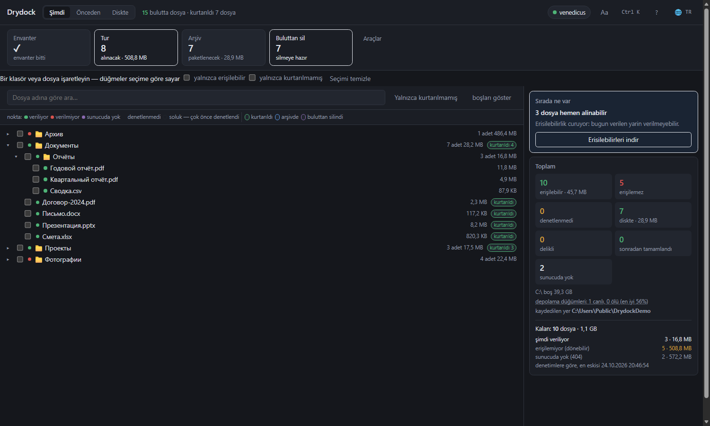

# Drydock

Bulut dosyaları vermeyi bıraktığında Yandex.Disk'ten kurtarır: koleksiyonu
listeler, erişilebilirliği denetler, verileni indirir, heşleri doğrular,
arşivlere paketler.

[Русский](../README.md) · [English](README.en.md) · **Türkçe** ·
[Қазақша](README.kk.md) · [Oʻzbekcha](README.uz.md) ·
[Azərbaycanca](README.az.md)

MIT · Windows · Python 3.12+ · Yandex ile bağlantılı değildir




## Ne yapar

| Eylem | Ne yapar |
|---|---|
| **Envanter** | bulutu dolaşıp adı, boyutu, heşleri ve ağaçtaki yerini kaydeder — artık indirilemeyenler dahil |
| **Denetim** | indirmeden erişilebilirliği kontrol eder: ilk ve son bayt |
| **Tur** | verilen her şeyi indirir, verilmeyenleri durdurulana kadar yeniden dener |
| **Arşiv** | kurtarılanı 3.9 GB, 1.9 GB ciltlere veya tek dosyaya paketler |
| **Silme** | doğrulanmış olanlarla bulutu boşaltır; üç katı seviye |
| **Sağlık** | neden olmadığını gösterir: nedenler, düğümler, görevler |

Ayrıca: önizlemeler, elle kurtarılan dosyaların hesaba katılması, aynanın
diskle eşitlenmesi, otopilot, komut paleti `Ctrl+K`, altı dil, koyu ve açık tema.

## Hızlı başlangıç

Windows, Python 3.12+ ve [7-Zip](https://www.7-zip.org/) gerekir.

**Hazır dosya** — [sürümlerden](https://github.com/venedicus/drydock/releases/latest) `Drydock.exe`. Python gerekmez, yalnızca [7-Zip](https://www.7-zip.org/).

```powershell
git clone https://github.com/venedicus/drydock.git
cd drydock
py -3.12 -m venv .venv
.venv\Scripts\python.exe -m pip install -e .
```

`Drydock.bat` ile başlatın. Pencere `http://127.0.0.1:8765` adresinde açılır.

1. **Erişim** — [Yandex poligonundan](https://yandex.ru/dev/disk/poligon/) belirteci
   yapıştırın veya `YANDEX_DISK_TOKEN` ayarlayın.
2. **Ayarlar** — `files/`, `meta/`, `archives/`, `catalog.db` için klasör seçin.
3. **Envanter** — bitmesini bekleyin.
4. **Tur** — çalışır bırakın.

## Belgeler

- [Nasıl çalışır](how-it-works.en.md) — envanter, denetim, indirme, doğrulama, arşiv, silme
- [Sınırlar](limitations.en.md) — ne yapmaz ve neden
- [Karşılaştırma](comparison.en.md) — Drydock, senkron istemcisi ve rclone
- [Katkı](../CONTRIBUTING.md) · [Güvenlik](../SECURITY.md) · [Değişiklikler](../CHANGELOG.md)

## Nasıl yardım edilir

- **Yıldız verin** — projeyi başkaları böyle buluyor.
- **Yazara teşekkür et** — [bağış sayfası](https://venedicus.github.io/drydock/).
- **İşe yaradıysa anlatın** — sayılarla bir issue: kaç dosya, ne olmadı.
- **Sayıların uyuşmadığını bildirin** — bu yeni özelliklerden daha önemli.
- **Çeviriyi düzeltin** — altı dil var, herhangi biri koddan geride kalabilir.

---

© 2026 venedicus · MIT · “Yandex.Disk” hak sahibinin ticari markasıdır; bu
proje Yandex ile bağlantılı değildir.
