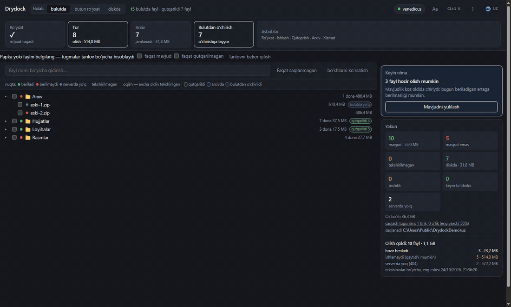

# Drydock

Bulut fayllarni bera olmay qolganda Yandex.Disk dan qutqaradi: toʻplamni
roʻyxatga oladi, ishlashini tekshiradi, berilganini yuklaydi, xeshlarni
solishtiradi, arxivlarga jamlaydi.

Oʻz toʻplamim uchun yozilgan: birinchi kuni yarmini chiqardi, hozir deyarli
98%. Fayllar goh beriladi, goh berilmaydi, shuning uchun turni oʻchirmagan
maʼqul.

[Русский](../README.md) · [English](README.en.md) · [Türkçe](README.tr.md) ·
[Қазақша](README.kk.md) · **Oʻzbekcha** · [Azərbaycanca](README.az.md)

MIT · Windows · Python 3.12+ · Yandex bilan bogʻliq emas

[](https://venedicus.github.io/drydock/)




## Nima qiladi

| Amal | Nima qiladi |
|---|---|
| **Roʻyxat** | bulutni aylanib nomi, oʻlchami, xeshlari va daraxtdagi joyini yozadi — endi yuklanmaydiganlar bilan birga |
| **Tekshiruv** | yuklamasdan ishlashini tekshiradi: birinchi va oxirgi bayt |
| **Tur** | berilganning hammasini yuklaydi, berilmaydiganlarini toʻxtatmaguningizcha qayta tekshiradi |
| **Arxiv** | qutqarilganni 3.9 GB, 1.9 GB jildlarga yoki bitta faylga jamlaydi |
| **Oʻchirish** | tekshirilganlar bilan bulutni boʻshatadi; uch daraja |
| **Salomatlik** | nega chiqmayotganini koʻrsatadi: sabablar, tugunlar, vazifalar |

Yana: koʻrish rasmlari, qoʻlda qutqarilgan fayllarni hisobga olish, oynani disk
bilan solishtirish, avtopilot, `Ctrl+K` palitrasi, olti til, qorongʻi va yorugʻ mavzu.

## Tez boshlash

Windows, Python 3.12+ va [7-Zip](https://www.7-zip.org/) kerak.

**Tayyor fayl** — [relizlardan](https://github.com/venedicus/drydock/releases/latest) `Drydock.exe`. Python kerak emas, faqat [7-Zip](https://www.7-zip.org/).

```powershell
git clone https://github.com/venedicus/drydock.git
cd drydock
py -3.12 -m venv .venv
.venv\Scripts\python.exe -m pip install -e .
```

`Drydock.bat` bilan ishga tushiring. Oyna `http://127.0.0.1:8765` da ochiladi.

1. **Kirish** — [Yandex poligonidan](https://yandex.ru/dev/disk/poligon/) tokenni
   qoʻying yoki `YANDEX_DISK_TOKEN` oʻrnating.
2. **Sozlamalar** — `files/`, `meta/`, `archives/`, `catalog.db` uchun papka tanlang.
3. **Roʻyxat** — tugashini kuting.
4. **Tur** — ishlab tursin.

## Hujjatlar

- [Qanday ishlaydi](how-it-works.en.md) — roʻyxat, tekshiruv, yuklash, solishtirish, arxiv, oʻchirish
- [Cheklovlar](limitations.en.md) — nima qilmaydi va nega
- [Taqqoslash](comparison.en.md) — Drydock, sinxronlash klienti va rclone
- [Ishtirok](../CONTRIBUTING.md) · [Xavfsizlik](../SECURITY.md) · [Oʻzgarishlar](../CHANGELOG.md)

## Qanday yordam berish mumkin

- **Yulduzcha qoʻyish** — odamlar loyihani shu orqali topadi.
- **Muallifga minnatdorchilik** — [xayriya sahifasi](https://venedicus.github.io/drydock/).
- **Yordam bergan boʻlsa, aytib berish** — raqamlar bilan issue: qancha fayl, nima chiqmadi.
- **Raqamlar mos kelmasa, xabar berish** — bu yangi imkoniyatlardan muhimroq.
- **Tarjimani tuzatish** — olti til bor, har biri koddan orqada qolishi mumkin.

[](https://yoomoney.ru/to/4100117869777196) [](https://venedicus.github.io/drydock/) [](https://venedicus.github.io/drydock/) [](https://venedicus.github.io/drydock/)

---

© 2026 venedicus · MIT · «Yandex.Disk» — huquq egasining savdo belgisi, loyiha
Yandex bilan bogʻliq emas.
